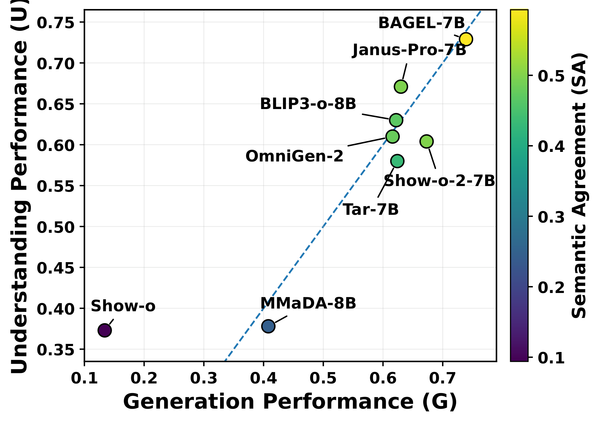

<p align="center">
<h1 align="center"><strong>XTC-Bench</strong><br><sub>Beyond Accuracy: Benchmarking Cross-Task Consistency in Unified Multimodal Models</sub></h1>
  <p align="center">
    Weixing Wang*&emsp;
    Liudvikas Zekas*&emsp;
    Anton Hackl*&emsp;
    Constantin Alexander Auga*
    <br>
    Parisa Shahabinejad&emsp;
    Jona Otholt&emsp;
    Antonio Rueda-Toicen&emsp;
    Gerard de Melo
    <br><br>
    Hasso Plattner Institute, University of Potsdam
    <br>
    <sub>* Equal contribution</sub>
    <br><br>
    <strong>WACV 2027</strong>
  </p>
</p>

<p align="center">
  <a href="https://arxiv.org/abs/2604.25072" target="_blank"></a>
  <a href="https://arxiv.org/abs/2604.25072" target="_blank"></a>
  <a href="https://arxiv.org/pdf/2604.25072" target="_blank"></a>
  <a href="https://weixingw.github.io/xtc-bench/" target="_blank"></a>
  <a href="https://huggingface.co/datasets/XTC-Bench/xtc-dataset" target="_blank"></a>
  <a href="LICENSE"></a>
  <a href="https://github.com/liudvikaszekas/xtc-benchmark" target="_blank"></a>
</p>

<p align="center">
  <b>Can a model understand what it can generate, and generate what it can understand?</b>
</p>

## 🏠 About

<p align="center">
  
</p>

Unified Multimodal Models (uMMs) aim to support both visual understanding and visual generation within a shared representation, yet existing protocols evaluate the two capabilities independently. **XTC-Bench is a scene-graph-grounded evaluation framework that measures cross-task semantic consistency.** From a reference scene graph, we derive a generation prompt and fact-aligned understanding queries, which makes the two task outputs directly comparable across objects, attributes, and relations. **Our metric, Semantic Agreement (SA), compares the generation-side and understanding-side answers with each other** rather than only against the reference.

**Highlights**

- 📊 **1,970 curated scenes and 31,735 atomic facts** from COCO and Visual Genome, with one fact-aligned VQA pair per fact, available on [Hugging Face](https://huggingface.co/datasets/XTC-Bench/xtc-dataset)
- 🤖 **8 open-source unified models** ready to run, plus GPT and Gemini as commercial references in the paper
- 🔍 **Fine-grained diagnostics** that separate agreement from correctness and show how models fail: shared errors, contradictions, one-sided answers, or missing responses
- ⚙️ **End-to-end pipeline** that runs on a single machine or on a SLURM cluster

## 🔥 News

- **[2026-11]** XTC-Bench has been accepted to **WACV 2027**! 🎉
- **[2026-04-27]** The [paper](https://arxiv.org/abs/2604.25072) is available on arXiv.
- **[2026-04-21]** We released the code and the [XTC-Bench dataset](https://huggingface.co/datasets/XTC-Bench/xtc-dataset).

## 📋 Contents

- [🔍 Overview](#-overview)
- [📈 Results](#-results)
- [📦 Dataset](#-dataset)
- [🚀 Quick Start](#-quick-start)
- [🧪 Evaluate Your Own Model](#-evaluate-your-own-model)
- [🛠️ Advanced Usage](#️-advanced-usage)
- [🔗 Citation](#-citation)
- [📄 License](#-license)
- [👏 Acknowledgements](#-acknowledgements)

## 🔍 Overview

### Why cross-task consistency?

A model that is good at each task separately can still contradict itself. Each example below evaluates one model on one atomic fact across both tasks.

<p align="center">
  
  <br>
  
  <br>
  <em>Top: OmniGen-2 renders the car color as white and silver but answers the corresponding color question as blue. Bottom: BAGEL-7B recognizes the boat viewpoint as from the back but fails to render that viewpoint.</em>
</p>

### Metrics

| Metric | What it measures |
| :--- | :--- |
| **Generation (G)** | How faithfully generated images express the reference facts, scored with an LLM-as-judge protocol |
| **Understanding (U)** | VQA performance on questions derived from the same scene graph |
| **Semantic Agreement (SA)** | The share of facts on which generation and understanding give the same answer, whether both are correct or both make the same error |
| **CCTA / AW-CCTA** | Baselines that compare task-wise correctness scores rather than the answers themselves |

Every fact falls into exactly one outcome:

| Outcome | Condition | Counts as agreement |
| :--- | :--- | :-: |
| **Missing** | Either side has no response | ✗ |
| **Same-correct** | Both answers are correct | ✓ |
| **Same-wrong** | Both are wrong, with the same meaning | ✓ |
| **Different-wrong** | Both are wrong, and they contradict each other | ✗ |
| **One-sided** | Only one answer is correct | ✗ |

### Reference scene graphs

<p align="center">
  
</p>

Each reference image passes through three stages: scene graph generation with kMaX-DeepLab and Fair-PSG, graph refinement with VLM verification and object merging, and attribute generation from dual views of each object. The final graph is the source of both the generation prompt and the understanding questions.

## 📈 Results

> [!NOTE]
> These are the results of the WACV 2027 version. The [arXiv v1](https://arxiv.org/abs/2604.25072) from April 2026 reports earlier results, with CCTA as its main metric.

All scores are averaged over all reference facts, so facts that a model does not express count against it. Higher is better. Models are sorted by SA within each group, and the best open-source score in each column is in bold.

| Model | Generation | Fact Coverage | Understanding | SA | AW-SA |
| :--- | :-: | :-: | :-: | :-: | :-: |
| GPT-5 / GPT-Image-1.5<sup>†</sup> | 0.804 | 89.0% | 0.684 | 0.717 | 0.675 |
| Gemini-2.5 Flash | 0.795 | 87.6% | 0.740 | 0.694 | 0.689 |
| BAGEL-7B | **0.739** | **77.9%** | **0.729** | **0.593** | **0.554** |
| Show-o-2-7B | 0.673 | 70.2% | 0.604 | 0.498 | 0.440 |
| Janus-Pro-7B | 0.630 | 66.1% | 0.671 | 0.496 | 0.460 |
| OmniGen-2 | 0.616 | 56.9% | 0.610 | 0.478 | 0.456 |
| BLIP3-o-8B | 0.622 | 67.2% | 0.630 | 0.468 | 0.433 |
| Tar-7B | 0.624 | 65.7% | 0.580 | 0.430 | 0.389 |
| MMaDA-8B | 0.408 | 44.1% | 0.378 | 0.246 | 0.211 |
| Show-o | 0.134 | 14.9% | 0.373 | 0.094 | 0.080 |

<sub>† A composed reference of two separate models, so its SA is not interpreted as self-consistency. Commercial systems are excluded from open-source statistics.</sub>

<p align="center">
  
  <br>
  <em>Generation and understanding performance, colored by SA.</em>
</p>

### Key findings

- **Disagreement is the norm.** Open-source SA ranges from 0.09 to 0.59, and seven of the eight models agree with themselves on fewer than half of all facts.
- **It persists at commercial scale.** Gemini-2.5 Flash, the native commercial model, reaches only 0.694.
- **Models contradict themselves.** When both tasks answer incorrectly, the two answers usually differ: different-wrong accounts for 52.7% to 75.1% of those facts.
- **Relations are the bottleneck.** Averaged over the open-source models, SA is 0.482 for objects, 0.435 for attributes, and 0.321 for relations.
- **Score-based metrics overstate consistency.** CCTA overstates SA by 1.3× for BAGEL-7B and up to 9.0× for Show-o. OmniGen-2 has the highest CCTA but ranks fifth on SA.

<details>
<summary><b>Generation and understanding in detail</b> (click to expand)</summary>

| Model | G All | Fact Cov. | G Obj | G Attr | G Rel | U All | U Obj | U Attr | U Rel |
| :--- | :-: | :-: | :-: | :-: | :-: | :-: | :-: | :-: | :-: |
| GPT-5 / GPT-Image-1.5 | .804 | 89.0% | .902 | .850 | .757 | .684 | .718 | .700 | .658 |
| Gemini-2.5 Flash | .795 | 87.6% | .889 | .842 | .749 | .740 | .686 | .708 | .789 |
| BAGEL-7B | .739 | 77.9% | .893 | .731 | .604 | .729 | .719 | .699 | .764 |
| Show-o-2-7B | .673 | 70.2% | .845 | .647 | .532 | .604 | .603 | .646 | .555 |
| Janus-Pro-7B | .630 | 66.1% | .813 | .571 | .506 | .671 | .627 | .633 | .743 |
| Tar-7B | .624 | 65.7% | .803 | .565 | .508 | .580 | .551 | .568 | .614 |
| BLIP3-o-8B | .622 | 67.2% | .807 | .551 | .518 | .630 | .578 | .586 | .713 |
| OmniGen-2 | .616 | 56.9% | .748 | .611 | .491 | .610 | .594 | .588 | .634 |
| MMaDA-8B | .408 | 44.1% | .599 | .369 | .264 | .378 | .417 | .432 | .281 |
| Show-o | .134 | 14.9% | .223 | .123 | .059 | .373 | .250 | .390 | .467 |

</details>

<details>
<summary><b>Semantic Agreement per dataset</b> (click to expand)</summary>

Brackets are 95% bootstrap confidence intervals over scenes.

| Model | SA All | COCO | Visual Genome | AW-SA |
| :--- | :-: | :-: | :-: | :-: |
| GPT-5 / GPT-Image-1.5 | .717 | .711 | .723 | .675 |
| Gemini-2.5 Flash | .694 | .683 | .705 | .689 |
| BAGEL-7B | .593 | .584 [.571, .597] | .602 [.587, .615] | .554 |
| Show-o-2-7B | .498 | .473 [.459, .487] | .524 [.510, .538] | .440 |
| Janus-Pro-7B | .496 | .469 [.455, .483] | .524 [.509, .538] | .460 |
| OmniGen-2 | .478 | .445 [.426, .463] | .512 [.495, .529] | .456 |
| BLIP3-o-8B | .468 | .444 [.430, .459] | .492 [.475, .506] | .433 |
| Tar-7B | .430 | .414 [.401, .428] | .445 [.431, .459] | .389 |
| MMaDA-8B | .246 | .228 [.216, .241] | .264 [.251, .277] | .211 |
| Show-o | .094 | .090 [.081, .100] | .097 [.088, .107] | .080 |

</details>

<details>
<summary><b>How models fail: outcomes per fact</b> (click to expand)</summary>

Percent of reference facts, pooled across COCO and Visual Genome. **Contradicted** is the share of both-wrong facts that are different-wrong.

| Model | Same-correct | Same-wrong | Different-wrong | One-sided | Missing | Contradicted |
| :--- | :-: | :-: | :-: | :-: | :-: | :-: |
| GPT-5 / GPT-Image-1.5 | 54.2 | 2.4 | 4.9 | 22.1 | 16.4 | 67.2 |
| Gemini-2.5 Flash | 54.4 | 1.8 | 3.2 | 19.5 | 21.1 | 64.1 |
| BAGEL-7B | 50.6 | 3.3 | 3.7 | 20.4 | 22.1 | 52.7 |
| Show-o-2-7B | 38.6 | 3.4 | 5.5 | 22.6 | 29.9 | 61.9 |
| Janus-Pro-7B | 38.6 | 3.0 | 6.0 | 18.4 | 34.0 | 66.6 |
| BLIP3-o-8B | 37.0 | 4.8 | 6.2 | 19.1 | 32.9 | 56.2 |
| OmniGen-2 | 36.7 | 2.3 | 2.8 | 14.8 | 43.3 | 55.1 |
| Tar-7B | 32.8 | 3.7 | 6.9 | 22.3 | 34.4 | 65.1 |
| MMaDA-8B | 16.0 | 2.5 | 7.5 | 18.0 | 56.0 | 75.1 |
| Show-o | 6.1 | 1.0 | 2.9 | 4.9 | 85.1 | 73.6 |

</details>

<details>
<summary><b>Comparison with CCTA and AW-CCTA</b> (click to expand)</summary>

These scores are computed on identical records, pooled per fact over both datasets. This aggregation differs from the tables above, so SA values differ from the main table.

| Model | CCTA | AW-CCTA | SA | AW-SA | CCTA / SA |
| :--- | :-: | :-: | :-: | :-: | :-: |
| OmniGen-2 | .764 | .391 | .390 | .367 | 2.0× |
| BAGEL-7B | .681 | .536 | .538 | .506 | 1.3× |
| MMaDA-8B | .676 | .184 | .185 | .160 | 3.7× |
| Show-o-2-7B | .671 | .421 | .420 | .386 | 1.6× |
| BLIP3-o-8B | .666 | .405 | .418 | .370 | 1.6× |
| Janus-Pro-7B | .639 | .415 | .416 | .386 | 1.5× |
| Tar-7B | .638 | .370 | .364 | .328 | 1.7× |
| Show-o | .636 | .080 | .071 | .061 | 9.0× |

</details>

## 📦 Dataset

The benchmark is built from images sampled from the COCO 2017 validation set and Visual Genome. The ground-truth bundles are available on [Hugging Face](https://huggingface.co/datasets/XTC-Bench/xtc-dataset) (about 6.4 GB). Each bundle holds 1,000 images, of which 985 have scored facts.

| Dataset | Scenes | Scored Facts | Facts/Scene | Obj/Scene | Rel/Scene | Attr/Scene | Obj. Retr. | Attr. Query | Rel. Query |
| :--- | :-: | :-: | :-: | :-: | :-: | :-: | :-: | :-: | :-: |
| COCO | 985 | 16,517 | 16.77 | 10.48 | 16.84 | 8.03 | 15.8% | 39.1% | 45.1% |
| Visual Genome | 985 | 15,218 | 15.45 | 8.22 | 11.70 | 6.76 | 16.1% | 40.0% | 43.9% |
| **Total** | **1,970** | **31,735** | 16.11 | 9.35 | 14.27 | 7.40 | 15.9% | 39.5% | 44.6% |

## 🚀 Quick Start

This is the fastest path to a local end-to-end run. It evaluates one model (`januspro`) on the precomputed ground truth, runs sequentially on a single machine, and does not need SLURM.

**Requirements:** Linux with bash, conda, and an NVIDIA GPU.

> [!NOTE]
> The pipeline currently reports Generation, Understanding, CCTA, and AW-CCTA. The code for Semantic Agreement is not in this repository yet.
>
> The quickstart config uses smaller judge and VLM models (Qwen2.5). The paper uses Qwen3-235B as the judge, so quickstart scores are not directly comparable to the results above. To change the models, see [Sequential mode](#sequential-mode-single-machine).

**1. Clone the repository with its submodules**

```bash
git clone --recursive https://github.com/liudvikaszekas/xtc-benchmark.git
cd xtc-benchmark
```

If you have already cloned it, run `git submodule update --init --recursive`. This fetches the code in `submodules/` (`kmax-deeplab`, `panoptic-scene-graph-generation`, and `univlm`).

**2. Run the core setup**

```bash
./setup/setup.sh --install-target temporary --run-tag xtc_core --recreate
```

This creates isolated conda environments under `.tmp/distros/`, initializes dependencies, and downloads the core model weights.

**3. Install the model stack for a JanusPro-only run**

```bash
SKIP_MODELS="blip3o,showo,showo2,mmada,omnigen2,tar,bagel,emu3" ./setup/setup_baselines.sh --recreate --conda-distro-tag xtc_core
```

**4. Download the ground-truth dataset**

```bash
./setup/download_xtc_dataset.sh
```

This places `gt-1000-coco/` and `gt-1000-vg/` in `datasets/xtc-dataset/`.

**5. Run the benchmark on both datasets**

```bash
python run_sequential.py --config configs/config_quickstart_januspro.json
```

```bash
python run_sequential.py --config configs/config_quickstart_januspro.json --images datasets/xtc-dataset/gt-1000-vg/images --gt-dataset datasets/xtc-dataset/gt-1000-vg --output-dir outputs/run_1000_vg
```

The first command runs on COCO and the second on Visual Genome. Add `--dry-run` to print each step's command without running it.

**6. Generate the evaluation report**

```bash
python scripts/evaluation/generate_evaluation_tables.py --run-dir outputs/run_1000_coco --run-dir outputs/run_1000_vg --models januspro --output outputs/tables_coco_vg_januspro.txt
```

This writes dataset statistics, generation and understanding scores, CCTA, AW-CCTA, and quadrant distributions to `outputs/tables_coco_vg_januspro.txt`.

## 🧪 Evaluate Your Own Model

### Models included

Pass any of these keys to `--models`. The setup script `setup/setup_baselines.sh` prepares them.

| Key | Model | Key | Model |
| :--- | :--- | :--- | :--- |
| `bagel` | [BAGEL-7B](https://huggingface.co/ByteDance-Seed/BAGEL-7B-MoT) | `omnigen2` | [OmniGen-2](https://huggingface.co/OmniGen2/OmniGen2) |
| `blip3o` | BLIP3-o-8B | `showo` | [Show-o](https://huggingface.co/showlab/show-o) |
| `januspro` | [Janus-Pro-7B](https://huggingface.co/deepseek-ai/Janus-Pro-7B) | `showo2` | [Show-o-2-7B](https://huggingface.co/showlab/show-o2-7B) |
| `mmada` | [MMaDA-8B](https://huggingface.co/Gen-Verse/MMaDA-8B-Base) | `tar` | [Tar-7B](https://huggingface.co/csuhan/Tar-Lumina2) |

### Adding a new model

XTC-Bench needs only two capabilities from a model: generating an image from text and answering a question about an image. To add a model:

1. In [`submodules/univlm/evaluation`](https://github.com/weixingW/univlm/tree/main/evaluation), subclass `RoundtripGenerator` from `roundtrip_base.py` and implement:
   - `_initialize_models()`
   - `generate_image_from_text(prompt, seed)`
   - `generate_caption_from_image(image, prompt)`, which is also used to answer VQA questions
2. Register the new class in `roundtrip_factory.py`.
3. Add an entry for the model to `MODEL_CONFIGS` in both `generate_images_all_models.py` and `answer_image_questions_all_models.py` in `scripts/evaluation/univlm_eval/`.
4. Run steps `8-19` with the precomputed ground truth:

```bash
python run_sequential.py --config configs/config_quickstart_januspro.json --models <your_model_key>
```

Have you evaluated a new model with XTC-Bench? We would love to hear about it, so please [open an issue](https://github.com/liudvikaszekas/xtc-benchmark/issues).

## 🛠️ Advanced Usage

### Pipeline steps

| Steps | Stage | What happens |
| :--- | :--- | :--- |
| `1-7` | Ground truth | Segmentation, scene graphs, relation refinement, graph merging, attributes, prompts, and questions. **Skip these by using the precomputed dataset.** |
| `8` | Generation | The evaluated model generates images from the prompts |
| `9-14` | Parsing | Scene graphs are extracted from the generated images and matched to the reference graphs |
| `15-16` | Generation scoring | Matched facts are scored by the LLM judge |
| `17-19` | Understanding | The evaluated model answers the questions, and the LLM judge scores the answers |

<details>
<summary><b>Sequential mode (single machine)</b> (click to expand)</summary>

### Sequential mode (single machine)

Full run, including ground-truth construction on your own images:

```bash
python run_sequential.py \
  --config configs/config_test_1000.json \
  --images /path/to/images \
  --output-dir outputs/my_run \
  --models januspro showo2 blip3o \
  --steps 1-19 \
  --llm-clean-refine Qwen/Qwen2.5-VL-7B-Instruct \
  --llm-attributes Qwen/Qwen2.5-VL-7B-Instruct \
  --llm-prompt Qwen/Qwen2.5-VL-7B-Instruct \
  --llm-judge Qwen/Qwen2.5-7B-Instruct \
  --num-gpus 1 \
  --conda-init 'source /path/to/miniconda3/etc/profile.d/conda.sh' \
  --save-logs
```

Prediction and evaluation only, reusing precomputed ground truth:

```bash
python run_sequential.py \
  --config configs/config_test_1000.json \
  --images /path/to/images \
  --output-dir outputs/my_run \
  --gt-dataset /path/to/precomputed_gt_bundle \
  --models januspro showo2 blip3o \
  --steps 8-19 \
  --save-logs
```

Config files for sequential runs:

- `configs/config_quickstart_januspro.json`: prefilled quickstart config (JanusPro + COCO defaults, no SLURM fields)
- `configs/config_sequential_template.json`: non-SLURM template with placeholders for custom setups

</details>

<details>
<summary><b>SLURM mode</b> (click to expand)</summary>

Run the full DAG:

```bash
python run_benchmark.py \
  --config configs/config_test_1000.json \
  --run-dir outputs/run_1000 \
  --steps "1-19"
```

Run only selected steps:

```bash
python run_benchmark.py --config configs/config_test_1000.json --run-dir outputs/run_1000 --steps "6,7,17-19"
```

Each step section can define a `slurm` dictionary. Keys map directly to `sbatch` arguments:

- `account`: Slurm billing account
- `partition`: cluster partition (for example `gpu-batch`)
- `constraint`: hardware constraint (for example `GPU_SKU:H100`)
- `gpus`: number of GPUs
- `mem`: memory per node
- `time`: wall time limit (for example `120:00:00`)
- `conda_env`: environment name to activate for the step

Example:

```json
"segmentation": {
  "slurm": {
    "account": "your_account",
    "partition": "gpu-batch",
    "constraint": "GPU_SKU:A100",
    "gpus": 1,
    "mem": "32G",
    "time": "32:00:00",
    "conda_env": "kmax_env"
  }
}
```

</details>

<details>
<summary><b>Configuration</b> (click to expand)</summary>

Start from `configs/config_test_1000.json` and replace the placeholders.

Key fields:

- `conda_init_script`: set this to the helper printed by `setup/setup.sh` (for example `source <...>/conda_init.sh`)
- `segmentation.img_dir_gt` and other required data and model paths
- `models`: list of image-generation models to run
- Per-step `slurm` blocks (`account`, `partition`, `gpus`, `mem`, `time`, `conda_env`)

For baseline path and config overrides, use:

- `evaluation.shared_model_config.model_paths.*`
- `evaluation.shared_model_config.config_paths.*`

</details>

<details>
<summary><b>Setup options</b> (click to expand)</summary>

#### Core setup (`setup/setup.sh`)

By default, this script:

- Creates benchmark conda environments from `setup/environments/*.yml`
- Initializes benchmark submodules
- Downloads required core model artifacts via `setup/download_models.sh`
- Prints a generated conda init helper path for config wiring

Recommended default (isolated and reproducible):

```bash
./setup/setup.sh --install-target temporary --recreate
```

Advanced mode (reuse an existing conda installation):

```bash
./setup/setup.sh --install-target existing --existing-conda-root "$(conda info --base)" --recreate
```

Useful options:

- `--skip-weights`: skip automatic core weight download
- `--only env1,env2`: create only selected envs
- `--skip-smoke`: skip import smoke checks
- `--blackwell`: use `scripts/pipeline/generate_any_scene/environment_blackwell.yml`

#### Baseline setup (`setup/setup_baselines.sh`)

Use this for the model stack (BLIP3o, Show-o/Show-o2, MMaDA, JanusPro, TAR, Bagel, OmniGen2).

```bash
./setup/setup_baselines.sh --recreate
```

This script:

- Creates or reuses a dedicated baseline conda env
- Downloads BLIP3o model artifacts
- Downloads Wan2.1 VAE for Show-o2
- Pre-downloads additional HF model repos referenced by the pipeline
- Generates a Show-o2 config override when the template is available

To skip selected model downloads (use valid model keys):

```bash
SKIP_MODELS="blip3o,januspro,mmada,omnigen2,tar,bagel,showo" ./setup/setup_baselines.sh --recreate
```

If you use an external UniVLM checkout:

```bash
UNIVLM_PATH=/absolute/path/to/univlm ./setup/setup_baselines.sh --recreate
```

#### Manual downloads

If automatic downloads are blocked in your environment, use:

```bash
./setup/download_models.sh --force
```

Expected core outputs:

- `weights/kmax_convnext_large.pth`
- `weights/models/masks-loc-sem/`

To download one ground-truth bundle only:

```bash
./setup/download_xtc_dataset.sh --subset coco
```

```bash
./setup/download_xtc_dataset.sh --subset vg
```

#### Gated models and storage

Some baseline wrappers may require gated Hugging Face models (for example dependencies used by TAR). See `submodules/univlm/README.md` for the current UniVLM-specific access and setup instructions.

Pre-downloading all baseline models can require hundreds of GB. Use `SKIP_MODELS` if you only need a subset.

</details>

<details>
<summary><b>Evaluation tables</b> (click to expand)</summary>

Use `scripts/evaluation/generate_evaluation_tables.py` to summarize completed runs.

```bash
python scripts/evaluation/generate_evaluation_tables.py --run-dir outputs/run_1000_coco --run-dir outputs/run_1000_vg --models januspro --output outputs/tables_coco_vg_januspro.txt
```

Each `--run-dir` must contain `final_graphs_pt/<model>/ige_scored_*.jsonl` and `vqa_outputs/<model>/scored_*.jsonl`. The output report contains Tables 0-5. If scores are missing, rerun steps `16-19` (or `8-19`).

Each ground-truth bundle contains the run structure expected by `run_sequential.py`:

`1_segmentation_gt`, `2_scene_graphs_gt`, `3_clean_and_refine_gt`, `4_graph_merge_gt`, `5_attributes_gt`, `6_prompt_generation`, `images`, `sg_with_attributes`, and `vqa_questions`.

</details>

## 🔗 Citation

If you find XTC-Bench useful in your research, please cite our paper and give this repository a star ⭐.

```bibtex
@misc{wang2026accuracybenchmarkingcrosstaskconsistency,
      title={Beyond Accuracy: Benchmarking Cross-Task Consistency in Unified Multimodal Models}, 
      author={Weixing Wang and Liudvikas Zekas and Anton Hackl and Constantin Alexander Auga and Parisa Shahabinejad and Jona Otholt and Antonio Rueda-Toicen and Gerard de Melo},
      year={2026},
      eprint={2604.25072},
      archivePrefix={arXiv},
      primaryClass={cs.CV},
      url={https://arxiv.org/abs/2604.25072}, 
}
```

## 📄 License

The code in this repository is released under the [MIT License](LICENSE). Submodules and the vendored `scripts/pipeline/generate_any_scene` keep their own licenses, and the images in the dataset remain subject to the terms of [COCO](https://cocodataset.org/#termsofuse) and [Visual Genome](https://homes.cs.washington.edu/~ranjay/visualgenome/index.html).

## 👏 Acknowledgements

XTC-Bench builds on [kMaX-DeepLab](https://github.com/bytedance/kmax-deeplab), [Fair-PSG](https://github.com/lorjul/panoptic-scene-graph-generation), [Generate Any Scene](https://github.com/RAIVNLab/GenerateAnyScene), [COCO](https://cocodataset.org/), and [Visual Genome](https://homes.cs.washington.edu/~ranjay/visualgenome/index.html). We thank the authors for making their work available.

The project on which this publication is based was funded by the Federal Ministry of Research, Technology and Space under the funding code "KI-Servicezentrum Berlin-Brandenburg" 16IS22092. Responsibility for the content of this publication remains with the author.

## 📬 Contact

For questions and bug reports, please [open an issue](https://github.com/liudvikaszekas/xtc-benchmark/issues). You can also reach us by email:

- Weixing Wang: weixing.wang@hpi.de
- Liudvikas Zekas: liudvikas.zekas@student.hpi.de
- Anton Hackl: anton.hackl@student.hpi.de
- Constantin Alexander Auga: constantin.auga@student.hpi.de
