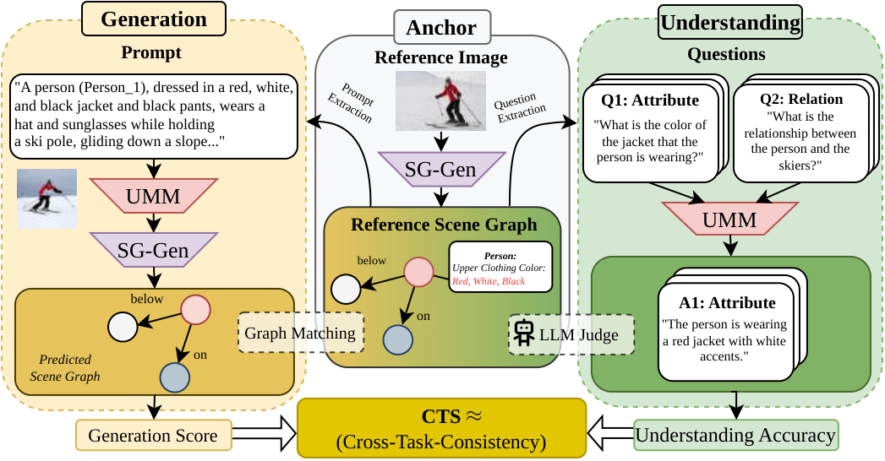
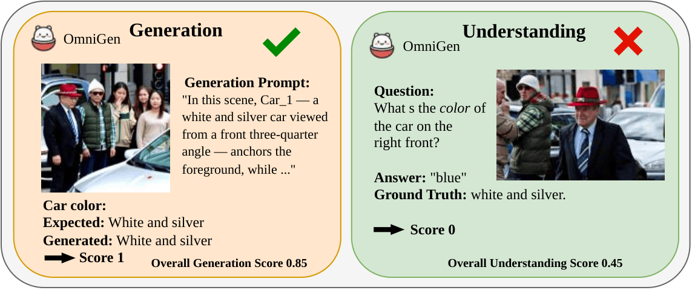
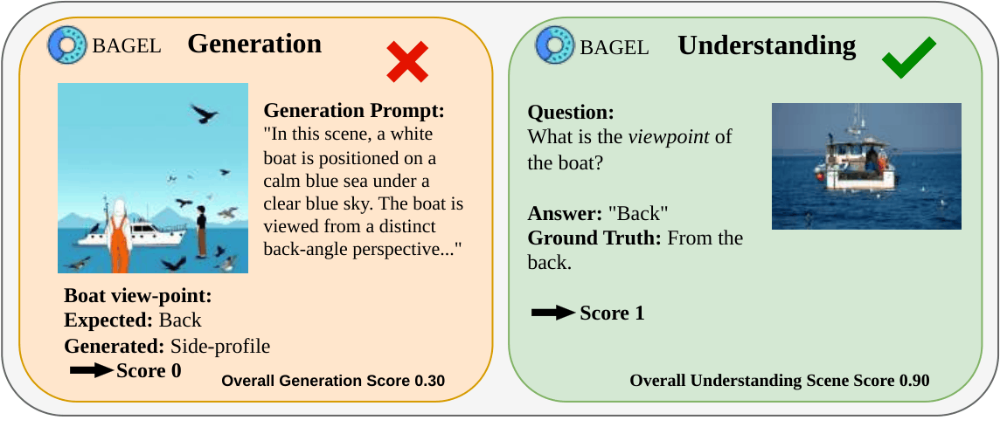
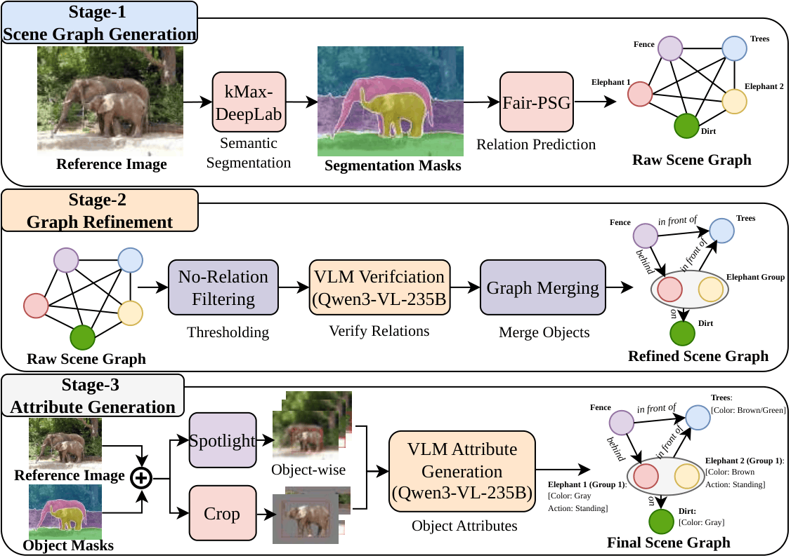

<p align="center">
<h1 align="center"><strong>XTC-Bench</strong><br><sub>Beyond Accuracy: Benchmarking Cross-Task Consistency in Unified Multimodal Models</sub></h1>
  <p align="center">
    Weixing Wang*&emsp;
    Liudvikas Zekas*&emsp;
    Anton Hackl*&emsp;
    Constantin Alexander Auga*
    <br>
    Parisa Shahabinejad&emsp;
    Jona Otholt&emsp;
    Antonio Rueda-Toicen&emsp;
    Gerard de Melo
    <br><br>
    Hasso Plattner Institute, University of Potsdam
    <br>
    <sub>* Equal contribution</sub>
    <br><br>
    <strong>WACV 2027</strong>
  </p>
</p>

<p align="center">
  <a href="https://arxiv.org/abs/2604.25072" target="_blank"></a>
  <a href="https://arxiv.org/abs/2604.25072" target="_blank"></a>
  <a href="https://arxiv.org/pdf/2604.25072" target="_blank"></a>
  <a href="https://weixingw.github.io/xtc-bench/" target="_blank"></a>
  <a href="https://huggingface.co/datasets/XTC-Bench/xtc-dataset" target="_blank"></a>
  <a href="LICENSE"></a>
  <a href="https://github.com/liudvikaszekas/xtc-benchmark" target="_blank"></a>
</p>

<p align="center">
  <b>Can a model understand what it can generate, and generate what it can understand?</b>
</p>

## 🏠 About

<p align="center">
  
</p>

Unified Multimodal Models (uMMs) aim to support both visual understanding and visual generation within a shared representation, yet existing protocols evaluate the two capabilities independently. **XTC-Bench is a scene-graph-grounded evaluation framework that measures cross-task visual semantic consistency.** Generation prompts and understanding queries are derived from the same scene graph, which enables fact-level comparison across objects, attributes, and relations. **Our metric, Continuous Cross-Task Agreement (CCTA), quantifies agreement between generation and understanding over matched atomic facts**, isolating internal consistency from standalone task accuracy.

**Highlights**

- 📊 **2,000 curated images and 31,530 facts** from COCO and Visual Genome, with precomputed scene graphs, prompts, and questions on [Hugging Face](https://huggingface.co/datasets/XTC-Bench/xtc-dataset)
- 🤖 **8 open-source unified models** ready to run, plus GPT and Gemini as commercial references in the paper
- 🔍 **Fine-grained diagnostics** for objects, attributes, and relations, using four scores: Generation, Understanding, CCTA, and AW-CCTA
- ⚙️ **End-to-end pipeline** that runs on a single machine or on a SLURM cluster

## 🔥 News

- **[2026-11]** XTC-Bench has been accepted to **WACV 2027**! 🎉
- **[2026-04-27]** The [paper](https://arxiv.org/abs/2604.25072) is available on arXiv.
- **[2026-04-21]** We released the code and the [XTC-Bench dataset](https://huggingface.co/datasets/XTC-Bench/xtc-dataset).

## 📋 Contents

- [🔍 Overview](#-overview)
- [📈 Results](#-results)
- [📦 Dataset](#-dataset)
- [🚀 Quick Start](#-quick-start)
- [🧪 Evaluate Your Own Model](#-evaluate-your-own-model)
- [🛠️ Advanced Usage](#️-advanced-usage)
- [🔗 Citation](#-citation)
- [📄 License](#-license)
- [👏 Acknowledgements](#-acknowledgements)

## 🔍 Overview

### Why cross-task consistency?

A model that is good at each task separately can still contradict itself. These two examples show the same model succeeding at one task and failing at the other on the same kind of fact.

<p align="center">
  
  <br>
  
  <br>
  <em>OmniGen can generate attribute details while failing to recognize them (top), whereas BAGEL understands relational viewpoints that it fails to render (bottom).</em>
</p>

### Metrics

| Metric | What it measures |
| :--- | :--- |
| **Generation (G)** | How faithfully generated images reflect the reference scene graph, scored with an LLM-as-judge protocol |
| **Understanding (U)** | VQA performance on questions derived from the same scene graph |
| **CCTA** | Semantic agreement between generation and understanding over matched atomic facts |
| **AW-CCTA** | Accuracy-weighted CCTA, which separates models that are consistently right from models that are consistently wrong |

### Reference scene graphs

<p align="center">
  
</p>

Each reference image passes through three stages: scene graph generation with kMaX-DeepLab and Fair-PSG, graph refinement with VLM verification and object merging, and attribute generation from dual views of each object. The final graph is the source of both the generation prompt and the understanding questions.

## 📈 Results

Benchmark results from the paper, sorted by AW-CCTA. Higher is better, and the best score in each column is in bold. Please refer to [our paper](https://arxiv.org/abs/2604.25072) for the full analysis.

| Model | Architecture | Generation | Understanding | CCTA | AW-CCTA |
| :--- | :--- | :-: | :-: | :-: | :-: |
| Gemini-2.5 Flash | Commercial | 0.795 | **0.740** | **0.706** | **0.623** |
| BAGEL-7B | AR+Diffusion | 0.725 | 0.724 | 0.675 | 0.569 |
| BLIP3-o-8B | Pure AR | 0.545 | 0.692 | 0.598 | 0.423 |
| Janus-Pro-7B | Pure AR | 0.499 | 0.681 | 0.573 | 0.390 |
| OmniGen-2 | Pure AR | 0.499 | 0.659 | 0.585 | 0.377 |
| Tar-7B | Pure AR | 0.518 | 0.580 | 0.600 | 0.358 |
| Show-o-2-7B | AR+Diffusion | 0.465 | 0.605 | 0.582 | 0.333 |
| MMaDA-8B | Pure Diffusion | 0.265 | 0.380 | 0.630 | 0.144 |
| Show-o | AR+Diffusion | 0.060 | 0.503 | 0.509 | 0.054 |
| GPT-5 / GPT-Image-1.5<sup>†</sup> | Commercial | **0.804** | 0.684 | – | – |

<sub>† Reported for Generation and Understanding only, as a strong reference for the two standalone tasks.</sub>

### Key findings

- **Consistency remains an open problem.** The strongest CCTA reaches only 0.706, and the best open-source model, BAGEL-7B, reaches 0.675.
- **Accuracy does not imply consistency.** Janus-Pro-7B ranks third among open-source models on understanding but second to last on CCTA.
- **Models can be consistently wrong.** MMaDA-8B has the second-highest open-source CCTA (0.630) but a low AW-CCTA (0.144), which reveals consistent hallucination.
- **Understanding usually leads generation.** Seven of the eight open-source models score higher on understanding than on generation.
- **Unification alone is not enough.** Consistency is governed by how tightly learning objectives are coupled across modalities, not by architectural unification alone.

<details>
<summary><b>Generation scores in detail</b> (click to expand)</summary>

| Model | Overall | Matched Nodes | Attr. | Rel. | Matched Attr. | Matched Rel. |
| :--- | :-: | :-: | :-: | :-: | :-: | :-: |
| GPT-5 / GPT-Image-1.5 | 0.804 | 89.0% | 0.850 | 0.757 | 0.889 | 0.917 |
| Gemini-2.5 Flash | 0.795 | 87.6% | 0.842 | 0.749 | 0.888 | 0.906 |
| BLIP3-o-8B | 0.545 | 67.9% | 0.591 | 0.502 | 0.716 | 0.896 |
| Tar-7B | 0.518 | 62.5% | 0.564 | 0.479 | 0.743 | 0.902 |
| Janus-Pro-7B | 0.499 | 62.2% | 0.557 | 0.455 | 0.799 | 0.908 |
| OmniGen-2 | 0.499 | 80.1% | 0.593 | 0.411 | 0.867 | 0.909 |
| Show-o | 0.060 | 14.3% | 0.083 | 0.041 | 0.703 | 0.893 |
| Show-o-2-7B | 0.465 | 62.3% | 0.534 | 0.411 | 0.829 | 0.848 |
| BAGEL-7B | 0.725 | 79.3% | 0.782 | 0.670 | 0.855 | 0.912 |
| MMaDA-8B | 0.265 | 39.1% | 0.347 | 0.201 | 0.713 | 0.871 |

</details>

<details>
<summary><b>Understanding scores in detail</b> (click to expand)</summary>

| Model | Overall | Obj. Retr. | Attr. Query | Rel. Query | Matched Attr. | Matched Rel. |
| :--- | :-: | :-: | :-: | :-: | :-: | :-: |
| GPT-5 / GPT-Image-1.5 | 0.684 | 0.718 | 0.700 | 0.658 | 0.702 | 0.662 |
| Gemini-2.5 Flash | 0.740 | 0.686 | 0.708 | 0.789 | 0.710 | 0.793 |
| BLIP3-o-8B | 0.692 | 0.679 | 0.677 | 0.709 | 0.688 | 0.740 |
| Tar-7B | 0.580 | 0.557 | 0.591 | 0.580 | 0.612 | 0.615 |
| Janus-Pro-7B | 0.681 | 0.616 | 0.665 | 0.719 | 0.682 | 0.745 |
| OmniGen-2 | 0.659 | 0.672 | 0.666 | 0.649 | 0.688 | 0.695 |
| Show-o | 0.503 | 0.415 | 0.579 | 0.467 | 0.632 | 0.582 |
| Show-o-2-7B | 0.605 | 0.583 | 0.664 | 0.560 | 0.677 | 0.589 |
| BAGEL-7B | 0.724 | 0.674 | 0.704 | 0.759 | 0.711 | 0.767 |
| MMaDA-8B | 0.380 | 0.377 | 0.484 | 0.289 | 0.515 | 0.330 |

</details>

<details>
<summary><b>Consistency scores in detail</b> (click to expand)</summary>

| Model | CCTA | CCTA Attr. | CCTA Rel. | AW-CCTA | AW-CCTA Attr. | AW-CCTA Rel. |
| :--- | :-: | :-: | :-: | :-: | :-: | :-: |
| Gemini-2.5 Flash | 0.706 | 0.708 | 0.705 | 0.623 | 0.620 | 0.625 |
| BLIP3-o-8B | 0.598 | 0.625 | 0.573 | 0.423 | 0.448 | 0.400 |
| Tar-7B | 0.600 | 0.630 | 0.574 | 0.358 | 0.394 | 0.327 |
| Janus-Pro-7B | 0.573 | 0.610 | 0.544 | 0.390 | 0.415 | 0.370 |
| OmniGen-2 | 0.585 | 0.615 | 0.557 | 0.377 | 0.439 | 0.320 |
| Show-o | 0.509 | 0.461 | 0.548 | 0.054 | 0.068 | 0.042 |
| Show-o-2-7B | 0.582 | 0.592 | 0.574 | 0.333 | 0.395 | 0.285 |
| BAGEL-7B | 0.675 | 0.696 | 0.654 | 0.569 | 0.588 | 0.550 |
| MMaDA-8B | 0.630 | 0.590 | 0.662 | 0.144 | 0.215 | 0.088 |

</details>

<details>
<summary><b>Architecture family averages</b> (click to expand)</summary>

| Family | Mean G | Mean U | G–U Gap | Mean CCTA | Mean AW-CCTA |
| :--- | :-: | :-: | :-: | :-: | :-: |
| Pure Diffusion (MMaDA) | 0.265 | 0.380 | −0.115 | 0.630 | 0.144 |
| AR+Diffusion (Show-o, Show-o2, BAGEL) | 0.417 | 0.611 | −0.194 | 0.589 | 0.319 |
| Pure AR (OmniGen-2, BLIP3-o, Janus-Pro, Tar) | 0.515 | 0.653 | −0.138 | 0.589 | 0.387 |

</details>

## 📦 Dataset

The benchmark is built from images sampled from the COCO 2017 validation set and Visual Genome. The ground-truth bundles are available on [Hugging Face](https://huggingface.co/datasets/XTC-Bench/xtc-dataset) (about 6.4 GB).

| Dataset | Images | Facts | Avg. Obj/Img | Avg. Rel/Img | Avg. Attr/Img | Obj. Retr. | Attr. Query | Rel. Query |
| :--- | :-: | :-: | :-: | :-: | :-: | :-: | :-: | :-: |
| COCO | 1,000 | 16,618 | 10.48 | 16.84 | 8.03 | 15.9% | 39.5% | 44.6% |
| Visual Genome | 1,000 | 14,912 | 8.22 | 11.70 | 6.76 | 16.1% | 39.3% | 44.6% |
| **Total** | **2,000** | **31,530** | | | | | | |

## 🚀 Quick Start

This is the fastest path to a local end-to-end run. It evaluates one model (`januspro`) on the precomputed ground truth, runs sequentially on a single machine, and does not need SLURM.

**Requirements:** Linux with bash, conda, and an NVIDIA GPU.

> [!NOTE]
> The quickstart config uses smaller judge and VLM models (Qwen2.5). The paper uses Qwen3-235B as the judge, so quickstart scores are not directly comparable to the table above. To change the models, see [Sequential mode](#sequential-mode-single-machine).

**1. Clone the repository with its submodules**

```bash
git clone --recursive https://github.com/liudvikaszekas/xtc-benchmark.git
cd xtc-benchmark
```

If you have already cloned it, run `git submodule update --init --recursive`. This fetches the code in `submodules/` (`kmax-deeplab`, `panoptic-scene-graph-generation`, and `univlm`).

**2. Run the core setup**

```bash
./setup/setup.sh --install-target temporary --run-tag xtc_core --recreate
```

This creates isolated conda environments under `.tmp/distros/`, initializes dependencies, and downloads the core model weights.

**3. Install the model stack for a JanusPro-only run**

```bash
SKIP_MODELS="blip3o,showo,showo2,mmada,omnigen2,tar,bagel,emu3" ./setup/setup_baselines.sh --recreate --conda-distro-tag xtc_core
```

**4. Download the ground-truth dataset**

```bash
./setup/download_xtc_dataset.sh
```

This places `gt-1000-coco/` and `gt-1000-vg/` in `datasets/xtc-dataset/`.

**5. Run the benchmark on both datasets**

```bash
python run_sequential.py --config configs/config_quickstart_januspro.json
```

```bash
python run_sequential.py --config configs/config_quickstart_januspro.json --images datasets/xtc-dataset/gt-1000-vg/images --gt-dataset datasets/xtc-dataset/gt-1000-vg --output-dir outputs/run_1000_vg
```

The first command runs on COCO and the second on Visual Genome. Add `--dry-run` to print each step's command without running it.

**6. Generate the evaluation report**

```bash
python scripts/evaluation/generate_evaluation_tables.py --run-dir outputs/run_1000_coco --run-dir outputs/run_1000_vg --models januspro --output outputs/tables_coco_vg_januspro.txt
```

This writes dataset statistics, generation and understanding scores, CCTA, AW-CCTA, and quadrant distributions to `outputs/tables_coco_vg_januspro.txt`.

## 🧪 Evaluate Your Own Model

### Models included

Pass any of these keys to `--models`. The setup script `setup/setup_baselines.sh` prepares them.

| Key | Model | Key | Model |
| :--- | :--- | :--- | :--- |
| `bagel` | [BAGEL-7B](https://huggingface.co/ByteDance-Seed/BAGEL-7B-MoT) | `omnigen2` | [OmniGen-2](https://huggingface.co/OmniGen2/OmniGen2) |
| `blip3o` | BLIP3-o-8B | `showo` | [Show-o](https://huggingface.co/showlab/show-o) |
| `januspro` | [Janus-Pro-7B](https://huggingface.co/deepseek-ai/Janus-Pro-7B) | `showo2` | [Show-o-2-7B](https://huggingface.co/showlab/show-o2-7B) |
| `mmada` | [MMaDA-8B](https://huggingface.co/Gen-Verse/MMaDA-8B-Base) | `tar` | [Tar-7B](https://huggingface.co/csuhan/Tar-Lumina2) |

### Adding a new model

XTC-Bench needs only two capabilities from a model: generating an image from text and answering a question about an image. To add a model:

1. In [`submodules/univlm/evaluation`](https://github.com/weixingW/univlm/tree/main/evaluation), subclass `RoundtripGenerator` from `roundtrip_base.py` and implement:
   - `_initialize_models()`
   - `generate_image_from_text(prompt, seed)`
   - `generate_caption_from_image(image, prompt)`, which is also used to answer VQA questions
2. Register the new class in `roundtrip_factory.py`.
3. Add an entry for the model to `MODEL_CONFIGS` in both `generate_images_all_models.py` and `answer_image_questions_all_models.py` in `scripts/evaluation/univlm_eval/`.
4. Run steps `8-19` with the precomputed ground truth:

```bash
python run_sequential.py --config configs/config_quickstart_januspro.json --models <your_model_key>
```

Have you evaluated a new model with XTC-Bench? We would love to hear about it, so please [open an issue](https://github.com/liudvikaszekas/xtc-benchmark/issues).

## 🛠️ Advanced Usage

### Pipeline steps

| Steps | Stage | What happens |
| :--- | :--- | :--- |
| `1-7` | Ground truth | Segmentation, scene graphs, relation refinement, graph merging, attributes, prompts, and questions. **Skip these by using the precomputed dataset.** |
| `8` | Generation | The evaluated model generates images from the prompts |
| `9-14` | Parsing | Scene graphs are extracted from the generated images and matched to the reference graphs |
| `15-16` | Generation scoring | Matched facts are scored by the LLM judge |
| `17-19` | Understanding | The evaluated model answers the questions, and the LLM judge scores the answers |

<details>
<summary><b>Sequential mode (single machine)</b> (click to expand)</summary>

### Sequential mode (single machine)

Full run, including ground-truth construction on your own images:

```bash
python run_sequential.py \
  --config configs/config_test_1000.json \
  --images /path/to/images \
  --output-dir outputs/my_run \
  --models januspro showo2 blip3o \
  --steps 1-19 \
  --llm-clean-refine Qwen/Qwen2.5-VL-7B-Instruct \
  --llm-attributes Qwen/Qwen2.5-VL-7B-Instruct \
  --llm-prompt Qwen/Qwen2.5-VL-7B-Instruct \
  --llm-judge Qwen/Qwen2.5-7B-Instruct \
  --num-gpus 1 \
  --conda-init 'source /path/to/miniconda3/etc/profile.d/conda.sh' \
  --save-logs
```

Prediction and evaluation only, reusing precomputed ground truth:

```bash
python run_sequential.py \
  --config configs/config_test_1000.json \
  --images /path/to/images \
  --output-dir outputs/my_run \
  --gt-dataset /path/to/precomputed_gt_bundle \
  --models januspro showo2 blip3o \
  --steps 8-19 \
  --save-logs
```

Config files for sequential runs:

- `configs/config_quickstart_januspro.json`: prefilled quickstart config (JanusPro + COCO defaults, no SLURM fields)
- `configs/config_sequential_template.json`: non-SLURM template with placeholders for custom setups

</details>

<details>
<summary><b>SLURM mode</b> (click to expand)</summary>

Run the full DAG:

```bash
python run_benchmark.py \
  --config configs/config_test_1000.json \
  --run-dir outputs/run_1000 \
  --steps "1-19"
```

Run only selected steps:

```bash
python run_benchmark.py --config configs/config_test_1000.json --run-dir outputs/run_1000 --steps "6,7,17-19"
```

Each step section can define a `slurm` dictionary. Keys map directly to `sbatch` arguments:

- `account`: Slurm billing account
- `partition`: cluster partition (for example `gpu-batch`)
- `constraint`: hardware constraint (for example `GPU_SKU:H100`)
- `gpus`: number of GPUs
- `mem`: memory per node
- `time`: wall time limit (for example `120:00:00`)
- `conda_env`: environment name to activate for the step

Example:

```json
"segmentation": {
  "slurm": {
    "account": "your_account",
    "partition": "gpu-batch",
    "constraint": "GPU_SKU:A100",
    "gpus": 1,
    "mem": "32G",
    "time": "32:00:00",
    "conda_env": "kmax_env"
  }
}
```

</details>

<details>
<summary><b>Configuration</b> (click to expand)</summary>

Start from `configs/config_test_1000.json` and replace the placeholders.

Key fields:

- `conda_init_script`: set this to the helper printed by `setup/setup.sh` (for example `source <...>/conda_init.sh`)
- `segmentation.img_dir_gt` and other required data and model paths
- `models`: list of image-generation models to run
- Per-step `slurm` blocks (`account`, `partition`, `gpus`, `mem`, `time`, `conda_env`)

For baseline path and config overrides, use:

- `evaluation.shared_model_config.model_paths.*`
- `evaluation.shared_model_config.config_paths.*`

</details>

<details>
<summary><b>Setup options</b> (click to expand)</summary>

#### Core setup (`setup/setup.sh`)

By default, this script:

- Creates benchmark conda environments from `setup/environments/*.yml`
- Initializes benchmark submodules
- Downloads required core model artifacts via `setup/download_models.sh`
- Prints a generated conda init helper path for config wiring

Recommended default (isolated and reproducible):

```bash
./setup/setup.sh --install-target temporary --recreate
```

Advanced mode (reuse an existing conda installation):

```bash
./setup/setup.sh --install-target existing --existing-conda-root "$(conda info --base)" --recreate
```

Useful options:

- `--skip-weights`: skip automatic core weight download
- `--only env1,env2`: create only selected envs
- `--skip-smoke`: skip import smoke checks
- `--blackwell`: use `scripts/pipeline/generate_any_scene/environment_blackwell.yml`

#### Baseline setup (`setup/setup_baselines.sh`)

Use this for the model stack (BLIP3o, Show-o/Show-o2, MMaDA, JanusPro, TAR, Bagel, OmniGen2).

```bash
./setup/setup_baselines.sh --recreate
```

This script:

- Creates or reuses a dedicated baseline conda env
- Downloads BLIP3o model artifacts
- Downloads Wan2.1 VAE for Show-o2
- Pre-downloads additional HF model repos referenced by the pipeline
- Generates a Show-o2 config override when the template is available

To skip selected model downloads (use valid model keys):

```bash
SKIP_MODELS="blip3o,januspro,mmada,omnigen2,tar,bagel,showo" ./setup/setup_baselines.sh --recreate
```

If you use an external UniVLM checkout:

```bash
UNIVLM_PATH=/absolute/path/to/univlm ./setup/setup_baselines.sh --recreate
```

#### Manual downloads

If automatic downloads are blocked in your environment, use:

```bash
./setup/download_models.sh --force
```

Expected core outputs:

- `weights/kmax_convnext_large.pth`
- `weights/models/masks-loc-sem/`

To download one ground-truth bundle only:

```bash
./setup/download_xtc_dataset.sh --subset coco
```

```bash
./setup/download_xtc_dataset.sh --subset vg
```

#### Gated models and storage

Some baseline wrappers may require gated Hugging Face models (for example dependencies used by TAR). See `submodules/univlm/README.md` for the current UniVLM-specific access and setup instructions.

Pre-downloading all baseline models can require hundreds of GB. Use `SKIP_MODELS` if you only need a subset.

</details>

<details>
<summary><b>Evaluation tables</b> (click to expand)</summary>

Use `scripts/evaluation/generate_evaluation_tables.py` to summarize completed runs.

```bash
python scripts/evaluation/generate_evaluation_tables.py --run-dir outputs/run_1000_coco --run-dir outputs/run_1000_vg --models januspro --output outputs/tables_coco_vg_januspro.txt
```

Each `--run-dir` must contain `final_graphs_pt/<model>/ige_scored_*.jsonl` and `vqa_outputs/<model>/scored_*.jsonl`. The output report contains Tables 0-5. If scores are missing, rerun steps `16-19` (or `8-19`).

Each ground-truth bundle contains the run structure expected by `run_sequential.py`:

`1_segmentation_gt`, `2_scene_graphs_gt`, `3_clean_and_refine_gt`, `4_graph_merge_gt`, `5_attributes_gt`, `6_prompt_generation`, `images`, `sg_with_attributes`, and `vqa_questions`.

</details>

## 🔗 Citation

If you find XTC-Bench useful in your research, please cite our paper and give this repository a star ⭐.

```bibtex
@misc{wang2026accuracybenchmarkingcrosstaskconsistency,
      title={Beyond Accuracy: Benchmarking Cross-Task Consistency in Unified Multimodal Models}, 
      author={Weixing Wang and Liudvikas Zekas and Anton Hackl and Constantin Alexander Auga and Parisa Shahabinejad and Jona Otholt and Antonio Rueda-Toicen and Gerard de Melo},
      year={2026},
      eprint={2604.25072},
      archivePrefix={arXiv},
      primaryClass={cs.CV},
      url={https://arxiv.org/abs/2604.25072}, 
}
```

## 📄 License

The code in this repository is released under the [MIT License](LICENSE). Submodules and the vendored `scripts/pipeline/generate_any_scene` keep their own licenses, and the images in the dataset remain subject to the terms of [COCO](https://cocodataset.org/#termsofuse) and [Visual Genome](https://homes.cs.washington.edu/~ranjay/visualgenome/index.html).

## 👏 Acknowledgements

XTC-Bench builds on [kMaX-DeepLab](https://github.com/bytedance/kmax-deeplab), [Fair-PSG](https://github.com/lorjul/panoptic-scene-graph-generation), [Generate Any Scene](https://github.com/RAIVNLab/GenerateAnyScene), [COCO](https://cocodataset.org/), and [Visual Genome](https://homes.cs.washington.edu/~ranjay/visualgenome/index.html). We thank the authors for making their work available.

The project on which this publication is based was funded by the Federal Ministry of Research, Technology and Space under the funding code "KI-Servicezentrum Berlin-Brandenburg" 16IS22092. Responsibility for the content of this publication remains with the author.

## 📬 Contact

For questions and bug reports, please [open an issue](https://github.com/liudvikaszekas/xtc-benchmark/issues). You can also reach us by email:

- Weixing Wang: weixing.wang@hpi.de
- Liudvikas Zekas: Liudvikas.Zekas@student.hpi.uni-potsdam.de
- Anton Hackl: Anton.Hackl@student.hpi.uni-potsdam.de
- Constantin Alexander Auga: Constantin.Auga@student.hpi.uni-potsdam.de
